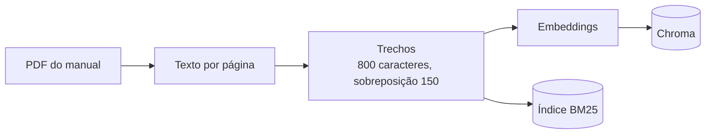
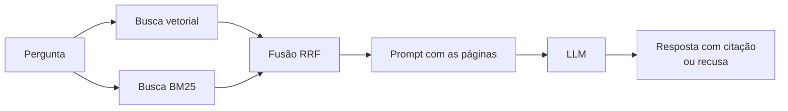

<div align="center">


**Busca e perguntas sobre manual de manutenção, com resposta citando a página**

[](https://www.python.org/)
[](LICENSE)
[](https://www.trychroma.com/)
[](https://www.sbert.net/)
[](https://github.com/dorianbrown/rank_bm25)
[](https://ollama.com/)
[](#limitações)

</div>

---

## Problema

Técnicos perdem tempo procurando informação em manuais longos.

## O que este projeto faz

Busca vetorial, por palavra (BM25) e híbrida (RRF) sobre o *Manual Geral de Instalação, Operação e Manutenção de Motores Elétricos* da WEG (seção em português). As respostas citam a página e o sistema recusa quando a informação não está no manual.

O código foi escrito passo a passo, sem LangChain, para enxergar cada etapa: extração com pypdf, trechos de 800 caracteres, embeddings multilíngues, Chroma, BM25 e fusão RRF.

## Arquitetura

Ingestão (uma vez):



Consulta (a cada pergunta):



## Resultados

Conjunto de teste inicial com 15 perguntas (em revisão), escritas a partir do manual: 2 sem resposta no documento e 13 avaliadas na busca (ver `GOLDEN_REVISAO.md`).

Configuração padrão (trechos de 800 caracteres, sobreposição de 150, modelo `paraphrase-multilingual-MiniLM-L12-v2`, 265 trechos em 77 páginas):

| Busca | hit@3 | MRR@10 |
|---|---|---|
| vetorial | 7/13 (54%) | 0,45 |
| bm25 | 9/13 (69%) | 0,68 |
| hibrida | 10/13 (77%) | 0,62 |

Cada pergunta vale cerca de 8 pontos percentuais. Diferença de 1 ou 2 perguntas é ruído: serve para comparar estratégias, não para prometer precisão.

### Experimentos (uma mudança por vez; hit@3 / MRR@10)

| Experimento | Trechos | vetorial | bm25 | hibrida | Hipótese confirmou? |
|---|---|---|---|---|---|
| base (800 / 150) | 265 | 7/13, 0,45 | 9/13, 0,68 | 10/13, 0,62 | |
| CHUNK 400 | 687 | 8/13, 0,55 | 9/13, 0,67 | 9/13, 0,63 | Em parte: a vetorial melhorou, a híbrida ficou igual no MRR e perdeu 1 acerto no hit@3. |
| CHUNK 1500 | 144 | 6/13, 0,42 | 9/13, 0,72 | 8/13, 0,61 | A vetorial piorou como esperado. A bm25 melhorou no MRR (0,72). |
| OVERLAP 0 | 236 | 6/13, 0,39 | 10/13, 0,78 | 7/13, 0,55 | A vetorial e a híbrida pioraram. A bm25 melhorou (surpresa). |
| Outro modelo de embedding | não feito | | | | Pulado para economizar disco. |
| Reranker (cross-encoder) | não feito | | | | Pulado: exigiria baixar outro modelo. Próximo passo. |

**Leitura honesta:** a busca por palavra (BM25) foi igual ou melhor que a híbrida no MRR em todas as configurações, e a híbrida só ganhou no hit@3 da configuração padrão (10 contra 9). Com 13 perguntas, não dá para afirmar que a híbrida é melhor aqui, porque um acerto a mais é ruído. O que se vê com clareza: a vetorial sozinha é a mais fraca em todos os casos (0,39 a 0,55 de MRR).
Nesta amostra, a sobreposição de 150 caracteres ajudou a busca vetorial e a híbrida (sem ela, hit@3 cai de 7 para 6 e de 10 para 7).

### Geração das respostas

Modelo local `qwen2.5:1.5b` (Ollama), busca híbrida, 5 trechos, temperatura 0. Avaliação manual (rascunho, em `results/respostas.md`):

- 4 de 13 corretas, 1 parcial, 8 erradas.
- Citou a página certa no texto: 4 de 13.
- Recusa correta nas 2 sem resposta: 2 de 2.
- 5 das 8 erradas foram **falsas recusas** ("Não encontrei isso no manual") mesmo quando a página certa estava nos trechos.
- A página certa estava entre os 5 trechos em 10 das 13 perguntas, mas o modelo só acertou 4 (mais 1 parcial). O gargalo da geração é o modelo pequeno: um modelo de 1,5 bilhão de parâmetros é fraco em português e em seguir o prompt. O resultado de geração diz mais sobre o modelo do que sobre a busca.

### O que aprendi

- **Principais causas de erro na busca** (híbrida, configuração padrão: 3 erros):
  - Vocabulário diferente do manual: "protetor contra ferrugem" contra "inibidor de oxidação" (página 20 nunca apareceu); "barulho estranho" contra "ruído elevado/anormal"; "mancal esquentando" contra "aquecimento do mancal".
  - A tabela "Problemas x Soluções" (página 76) é cortada em 5 trechos e só o primeiro leva o título. Os outros viram listas soltas de causas, sem o nome do problema, e perdem para páginas de acoplamento e alinhamento (33) que repetem as palavras "motor" e "mancal".
  - Os trechos não atravessam páginas, então procedimentos longos ficam espalhados.
- **O que a busca por palavra resolveu:** perguntas com termo exato (M10 e junta rígida, IP65, classe F, megômetro) sobem com BM25, e a vetorial perde parte delas. A BM25 ficou à frente da vetorial no hit@3 nos 4 cenários (9 contra 7, 9 contra 8, 9 contra 6 e 10 contra 6).
- **Problemas de extração do PDF** (5 trechos aleatórios inspecionados e mais algumas páginas de tabela):
  - Cabeçalho repetido em todo começo de página ("Motores Elétricos | 165 SEGURANÇA 3 SEGURANÇA ...") entra no texto do primeiro trecho.
  - Tabelas viram sopa de números e cabeçalhos se perdem (tabelas de lubrificação com números colados, como "200006"; a tabela de torque perde a ordem das colunas).
  - Há texto em inglês e alemão dentro de figuras e frases soltas no meio do português (por exemplo, "Repeat the stator drying process").
  - O número da página do PDF (índice) é diferente do impresso: página impressa = índice + 156.
- **Geração:** o prompt manda recusar quando não achar, e o modelo pequeno recusa até quando o trecho certo está lá. As duas perguntas sem resposta foram recusadas corretamente, mas ao custo de falsas recusas nas outras.

## Como rodar

```bash
uv venv && source .venv/bin/activate        # ou: python3 -m venv .venv
uv pip install torch --index-url https://download.pytorch.org/whl/cpu   # torch só CPU (menor)
uv pip install -r requirements.txt
```

**O manual não vai no repositório** (PDF de terceiros). Baixe o manual trilíngue da WEG (documento 50033244, revisão 43, 233 páginas):
`https://static.weg.net/medias/downloadcenter/ha6/h39/WEG-WMO-safe-area-50033244-manual-pt-en-es.pdf`
e extraia só a seção em português (páginas 157 a 233 do original) para `data/manual.pdf`:

```python
from pypdf import PdfReader, PdfWriter
r = PdfReader("WEG-WMO-safe-area-50033244-manual-pt-en-es.pdf"); w = PdfWriter()
for p in r.pages[156:]: w.add_page(p)
w.write("data/manual.pdf")
```

Depois:

```bash
python ingest.py data/manual.pdf     # extrai, divide em trechos, gera embeddings e indexa
python eval.py                       # mede vetorial, bm25 e híbrida
LLM_BASE_URL=http://localhost:11434/v1 LLM_API_KEY=ollama LLM_MODEL=qwen2.5:1.5b python gerar_respostas.py
```

O `ask.py` aceita qualquer API compatível com OpenAI. Para usar a OpenAI, defina `LLM_API_KEY` (sua chave) e `LLM_MODEL`; para o Ollama, use as variáveis do exemplo acima.

`gerar_respostas.py` roda o `ask.py` para as 15 perguntas e grava `results/respostas.md`. Saídas dos experimentos em `results/`.

## Estrutura do projeto

```
rag-manual-poc/
├── assets/logo.svg        # logo
├── data/                  # coloque aqui manual.pdf (não versionado)
├── results/               # saídas dos experimentos e respostas geradas
├── ingest.py              # PDF -> trechos -> embeddings -> Chroma + BM25
├── search.py              # busca vetorial, bm25 e híbrida (RRF)
├── ask.py                 # pergunta -> prompt com páginas -> LLM
├── eval.py                # hit@k e MRR sobre o conjunto de teste
├── gerar_respostas.py     # roda o ask.py nas 15 perguntas
├── config.py              # tamanho do trecho, sobreposição, modelo
├── golden.csv             # conjunto de teste inicial
├── GOLDEN_REVISAO.md      # notas para revisar o conjunto de teste
├── requirements.txt
└── LICENSE
```

## Como a avaliação funciona

O `golden.csv` usa `;` como separador e tem duas colunas: `pergunta` e `paginas` (páginas corretas separadas por `|`; `0` quando o manual não tem a resposta).

- **hit@3:** a pergunta conta como acerto se alguma página correta aparece entre os 3 primeiros resultados.
- **MRR@10:** média de 1 dividido pela posição da primeira página correta nos 10 primeiros resultados (0 se não aparecer).

## Limitações

- Trechos não atravessam páginas.
- Conjunto de teste pequeno (13 perguntas avaliáveis); serve para comparar, não para medir precisão real. O conjunto ainda está em revisão.
- 4 das 13 perguntas caem na mesma página (76), o que pesa nos números.
- **Sem reranker** e sem outro modelo de embedding (para economizar disco).
- Geração avaliada com um modelo local pequeno (`qwen2.5:1.5b`), então a nota de geração é pessimista; a avaliação manual também é rascunho, não foi conferida no PDF original.
- Extração do PDF sem tratamento de tabelas, cabeçalhos e rodapés.
- O PDF usado é só a seção em português (77 páginas) do manual trilíngue.

## Próximos passos

- Reranker (cross-encoder sobre os 20 candidatos da híbrida).
- Modelo de embedding multilíngue melhor (por exemplo, multilingual-e5).
- Dividir por seção, para que a tabela de problemas e soluções mantenha o título em cada trecho.
- Limpeza de cabeçalho e rodapé e tratamento de tabelas.
- Expansão de consulta com sinônimos do jargão técnico.
- Modelo de geração maior.
- Controle de acesso por documento.
- Mais perguntas de teste vindas de usuários reais e monitoramento de custo e de respostas sem fonte.

## Licença

O código é distribuído sob a licença [MIT](LICENSE). O manual da WEG não está incluído neste repositório e pertence à WEG.

## Autor

**Oséias Farias**

[LinkedIn](https://linkedin.com/in/oseiasfarias) · [GitHub](https://github.com/Oseiasdfarias)
