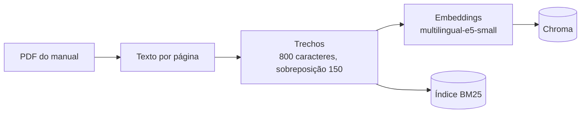
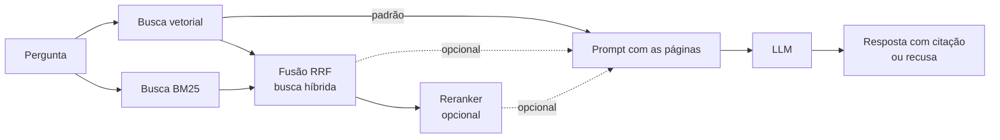

<div align="center">


**Busca e perguntas sobre manual de manutenção, com resposta citando a página**

[](https://www.python.org/)
[](LICENSE)
[](https://www.trychroma.com/)
[](https://www.sbert.net/)
[](https://github.com/dorianbrown/rank_bm25)
[](https://ollama.com/)
[](#testes)
[](#limitações)

</div>

---

## Problema

Técnicos perdem tempo procurando informação em manuais longos.

## O que este projeto faz

Busca vetorial, por palavra (BM25) e híbrida (RRF), com reranker opcional, sobre o *Manual Geral de Instalação, Operação e Manutenção de Motores Elétricos* da WEG (seção em português). As respostas citam a página e o sistema recusa quando a informação não está no manual.

O código foi escrito passo a passo, sem LangChain, para enxergar cada etapa: extração com pypdf, trechos, embeddings multilíngues, Chroma, BM25, fusão RRF e reranker. Ele é organizado em camadas, com testes unitários que rodam sem baixar modelo.

## Arquitetura

O código fica em `src/rag_manual/`, em quatro camadas. O domínio não importa nada das outras. A aplicação só conhece interfaces (portas). A infraestrutura (pypdf, Chroma, BM25, sentence-transformers, Ollama) implementa essas interfaces, e `composition.py` liga tudo. Detalhes, regra de dependência e como adicionar uma busca ou um LLM novo em [docs/arquitetura.md](docs/arquitetura.md).

Ingestão (uma vez):



Consulta (a cada pergunta). A busca padrão é a vetorial; a híbrida e o reranker são opcionais:



## Resultados

Conjunto de teste inicial com 15 perguntas (em revisão), escritas a partir do manual: 2 sem resposta no documento e 13 avaliadas na busca (ver [docs/golden_revisao.md](docs/golden_revisao.md)). O conjunto não foi editado durante os experimentos.

Cada pergunta vale cerca de 8 pontos percentuais. Diferença de 1 ou 2 perguntas é ruído: serve para comparar estratégias, não para prometer precisão.

### Comparação de configurações (hit@3 / MRR@10)

| Configuração | Trechos | vetorial | bm25 | híbrida | híbrida + reranker |
|---|---|---|---|---|---|
| base (800 / 150, MiniLM) | 265 | 7/13, 0,45 | 9/13, 0,68 | 10/13, 0,62 | 10/13, 0,67 |
| divisão por seção (B1) | 256 | 7/13, 0,51 | 10/13, 0,75 | 9/13, 0,66 | 10/13, 0,65 |
| **embedding e5 (B2), padrão** | 265 | **12/13, 0,87** | 9/13, 0,68 | 10/13, 0,80 | 10/13, 0,67 |
| seção + e5 (B1+B2) | 256 | 12/13, 0,84 | 10/13, 0,75 | 10/13, 0,75 | 11/13, 0,71 |

O reranker é o `cross-encoder/mmarco-mMiniLMv2-L12-H384-v1` sobre os 20 melhores candidatos da híbrida. A tabela completa (outros tamanhos de trecho, reranker sobre a vetorial, perguntas erradas de cada busca) está em [docs/experimentos.md](docs/experimentos.md) e em `results/eval_*.txt`. A base foi refeita pelo código novo e bateu com os números da primeira versão.

**Configuração padrão:** trechos de 800 caracteres com sobreposição de 150, modelo `intfloat/multilingual-e5-small`, busca vetorial, sem reranker. Foi escolhida só pelos números (hit@3 e MRR). O ADR com a decisão está em [docs/adr/0005-modelo-de-embedding.md](docs/adr/0005-modelo-de-embedding.md).

**Leitura honesta:**

- A melhoria clara foi trocar o modelo de embedding: a vetorial foi de 7/13 para 12/13 (MRR de 0,45 para 0,87), 5 perguntas a mais. Isso está bem acima do ruído.
- A divisão por seção e o reranker **não** deram ganho que se possa separar do ruído. O reranker até piorou com o e5 (a vetorial caiu de 12/13 para 9/13 ou 10/13 com ele).
- Com o e5, a vetorial sozinha ficou melhor que a híbrida (12/13 contra 10/13). Com o modelo antigo era o contrário no hit@3.
- A escolha da melhor configuração foi feita nas mesmas 13 perguntas, entre 7 índices e 5 estratégias. O 92% provavelmente está otimista. A ordem entre as três melhores linhas da tabela não é confiável.
- A pergunta do protetor contra ferrugem (página 20) errou em 32 das 35 combinações medidas: o manual diz "graxa protetiva" e "película protetora".

### Experimentos antigos (uma mudança por vez; hit@3 / MRR@10, sem reranker)

| Experimento | Trechos | vetorial | bm25 | híbrida |
|---|---|---|---|---|
| base (800 / 150) | 265 | 7/13, 0,45 | 9/13, 0,68 | 10/13, 0,62 |
| CHUNK 400 | 687 | 8/13, 0,55 | 9/13, 0,67 | 9/13, 0,63 |
| CHUNK 1500 | 144 | 6/13, 0,42 | 9/13, 0,72 | 8/13, 0,61 |
| OVERLAP 0 | 236 | 6/13, 0,39 | 10/13, 0,78 | 7/13, 0,55 |

Nesta amostra, a sobreposição de 150 caracteres ajudou a vetorial e a híbrida (sem ela, hit@3 cai de 7 para 6 e de 10 para 7). Esses números foram refeitos pelo código novo e deram o mesmo.

### Geração das respostas: qwen2.5:1.5b contra qwen2.5:3b

Modelos locais no Ollama, busca padrão (vetorial com e5), 5 trechos, temperatura 0. Nota manual feita por leitura, **rascunho para o Oséias revisar** (`results/respostas_e5_vetorial_*.md`).

| | qwen2.5:1.5b | qwen2.5:3b |
|---|---|---|
| Corretas (de 13) | 4 | 6 |
| Parciais | 1 | 1 |
| Erradas | 8 | 6 |
| Falsas recusas (página certa nos trechos) | 2 | 2 |
| Página certa citada no texto | 4 de 13 (2 só como lista de páginas) | 10 de 13 |
| Recusa correta nas 2 sem resposta | 2 de 2 | 2 de 2 |

- Com 13 perguntas, 2 acertos a mais não bastam para afirmar que o 3b é melhor. O que muda com clareza é o comportamento: o 3b cita a página e escreve a resposta; o 1.5b às vezes devolve só uma lista de páginas.
- Os dois erram o aperto do parafuso M10 (certo: 28 a 40 Nm), pegando a coluna errada da tabela que o PDF desorganiza. O 3b ainda inverteu a regra dos drenos do IP65.
- O 3b levou cerca de duas vezes o tempo do 1.5b em CPU.
- Com o 1.5b, a busca melhor (e5 vetorial) não mudou a nota (4 corretas, 1 parcial, 8 erradas), mas reduziu as falsas recusas de 5 para 2. O gargalo continua sendo o modelo pequeno.

### O que aprendi

- **Principais causas de erro na busca** (vetorial com e5, 1 erro; híbrida com MiniLM, 3 erros):
  - Vocabulário diferente do manual: "protetor contra ferrugem" contra "graxa protetiva" e "película protetora" (página 20); "barulho estranho" contra "ruído elevado/anormal"; "mancal esquentando" contra "aquecimento do mancal".
  - A tabela "Problemas x Soluções" (página 76) é cortada em 5 trechos e só o primeiro leva o título. A divisão por seção passou a pôr o título em todos, mas o título do capítulo não diz qual problema cada linha descreve, então o ganho na busca não apareceu.
  - Os trechos não atravessam páginas, então procedimentos longos ficam espalhados.
- **O que a busca por palavra resolveu:** perguntas com termo exato (M10 e junta rígida, IP65, classe F, megômetro) sobem com BM25. Com o modelo antigo, a BM25 ficou à frente da vetorial no hit@3 em todos os cenários.
- **Problemas de extração do PDF** (5 trechos aleatórios inspecionados e mais algumas páginas de tabela):
  - Cabeçalho repetido em todo começo de página ("Motores Elétricos | 165 SEGURANÇA ...") entra no texto do primeiro trecho. O chunker por seção remove esse cabeçalho.
  - Tabelas viram sopa de números e cabeçalhos se perdem (tabelas de lubrificação com números colados, como "200006"; a tabela de torque perde a ordem das colunas, o que explica o erro nas respostas do M10).
  - Há texto em inglês e alemão dentro de figuras e frases soltas no meio do português (por exemplo, "Repeat the stator drying process").
  - O número da página do PDF (índice) é diferente do impresso: página impressa = índice + 156.
- **Geração:** o prompt manda recusar quando não achar, e os modelos pequenos recusam até quando o trecho certo está lá. As duas perguntas sem resposta foram recusadas corretamente, mas ao custo de falsas recusas nas outras.

## Como rodar

```bash
uv venv && source .venv/bin/activate        # ou: python3 -m venv .venv
make install                                 # torch só CPU (menor) + o pacote + pytest e ruff
```

**O manual não vai no repositório** (PDF de terceiros). Baixe o manual trilíngue da WEG (documento 50033244, revisão 43, 233 páginas):
`https://static.weg.net/medias/downloadcenter/ha6/h39/WEG-WMO-safe-area-50033244-manual-pt-en-es.pdf`
e extraia só a seção em português (páginas 157 a 233 do original) para `data/manual.pdf`:

```python
from pypdf import PdfReader, PdfWriter
r = PdfReader("WEG-WMO-safe-area-50033244-manual-pt-en-es.pdf"); w = PdfWriter()
for p in r.pages[156:]: w.add_page(p)
w.write("data/manual.pdf")
```

Depois:

```bash
make ingest                                  # rag-manual ingest: extrai, divide, gera embeddings e indexa
make eval                                    # rag-manual eval: mede vetorial, bm25 e híbrida
make ask Q="Qual a altitude máxima de operação?"   # rag-manual ask "pergunta"
make answers                                 # responde as 15 perguntas e grava results/respostas.md
make experiments                             # roda todos os experimentos (precisa baixar os modelos)
```

Na primeira vez o `ingest` baixa o modelo e5 (cerca de 470 MB). O reranker (outros 470 MB) só é baixado se você usar `--reranker`.

Opções úteis da CLI (valem mais que as variáveis de ambiente):

```bash
rag-manual ingest --chunker section --index-dir db/secao     # outra divisão, em outra pasta
rag-manual eval --index-dir db/secao --reranker               # inclui a busca com reranker
rag-manual ask --retriever hibrida "sua pergunta"             # escolhe a busca
rag-manual experiment --list                                  # lista os experimentos
```

Para responder, a CLI usa qualquer API compatível com OpenAI. Para o Ollama:

```bash
LLM_BASE_URL=http://localhost:11434/v1 LLM_API_KEY=ollama LLM_MODEL=qwen2.5:3b make answers
```

Para usar a OpenAI, defina `LLM_API_KEY` (sua chave) e `LLM_MODEL`. Todas as variáveis estão em [docs/arquitetura.md](docs/arquitetura.md).

## Testes

```bash
make test      # ou: pytest
make lint      # ruff check e ruff format --check
```

Os testes unitários usam fakes das interfaces (portas), então rodam em menos de um segundo, sem baixar modelo e sem o PDF. Cobrem divisão em trechos, fusão RRF, métricas, montagem do prompt, os retrievers, a ingestão e a configuração.

## Estrutura do projeto

```
rag-manual-poc/
├── pyproject.toml         # pacote rag_manual, dependências, pytest e ruff
├── Makefile               # install, ingest, eval, ask, answers, experiments, test, lint
├── assets/logo.svg
├── data/                  # coloque aqui manual.pdf (não versionado)
├── results/               # saídas dos experimentos e das respostas geradas
├── docs/                  # arquitetura, avaliação, experimentos, ADRs
├── src/rag_manual/
│   ├── domain/            # modelos e portas (interfaces)
│   ├── application/       # ingestão, buscas, resposta, avaliação
│   ├── infrastructure/    # pypdf, Chroma, BM25, embeddings, reranker, LLM
│   ├── config.py          # configurações lidas do ambiente
│   ├── composition.py     # monta os objetos
│   ├── experiments.py     # lista de experimentos
│   └── cli.py             # comando rag-manual
├── tests/unit/            # testes unitários com fakes
├── golden.csv             # conjunto de teste inicial
└── LICENSE
```

## Documentação

| Documento | Conteúdo |
|---|---|
| [docs/arquitetura.md](docs/arquitetura.md) | camadas, regra de dependência, diagramas, como adicionar uma busca ou um LLM |
| [docs/avaliacao.md](docs/avaliacao.md) | formato do conjunto de teste, hit@k, MRR e como a geração é avaliada |
| [docs/experimentos.md](docs/experimentos.md) | todas as tabelas de experimentos, com conclusões |
| [docs/golden_revisao.md](docs/golden_revisao.md) | notas para revisar o conjunto de teste |
| [docs/adr/](docs/adr/) | decisões de arquitetura (layout, RRF, divisão por seção, reranker, embedding, LLM) |

## Como a avaliação funciona

O `golden.csv` usa `;` como separador e tem duas colunas: `pergunta` e `paginas` (páginas corretas separadas por `|`; `0` quando o manual não tem a resposta).

- **hit@3:** a pergunta conta como acerto se alguma página correta aparece entre os 3 primeiros resultados.
- **MRR@10:** média de 1 dividido pela posição da primeira página correta nos 10 primeiros resultados (0 se não aparecer).

Mais detalhes, inclusive a nota manual da geração, em [docs/avaliacao.md](docs/avaliacao.md).

## Limitações

- Trechos não atravessam páginas.
- Conjunto de teste pequeno (13 perguntas avaliáveis); serve para comparar, não para medir precisão real. O conjunto ainda está em revisão. A configuração padrão foi escolhida nele, então o resultado dela tende a estar otimista.
- 4 das 13 perguntas caem na mesma página (76), o que pesa nos números.
- Só um modelo de embedding alternativo (e5-small) e um reranker foram testados. Modelos maiores ficaram de fora para poupar disco.
- Geração avaliada com dois modelos locais pequenos (1,5 e 3 bilhões de parâmetros). A nota é manual e é rascunho: não foi conferida pelo Oséias nem no PDF original além das páginas citadas.
- Extração do PDF sem tratamento de tabelas. O cabeçalho é removido só no chunker por seção.
- O PDF usado é só a seção em português (77 páginas) do manual trilíngue.
- Não há integração contínua (CI) neste repositório. Os testes rodam localmente.

## Próximos passos

- Tratar a tabela de problemas e soluções linha por linha (problema, causa, solução).
- Expansão de consulta com sinônimos do jargão técnico.
- Outros modelos de embedding e de reranker, e um modelo de geração maior.
- Mais perguntas de teste vindas de usuários reais e monitoramento de custo e de respostas sem fonte.
- Controle de acesso por documento.

## Licença

O código é distribuído sob a licença [MIT](LICENSE). O manual da WEG não está incluído neste repositório e pertence à WEG.

## Autor

**Oséias Farias**

[LinkedIn](https://linkedin.com/in/oseiasfarias) · [GitHub](https://github.com/Oseiasdfarias)
