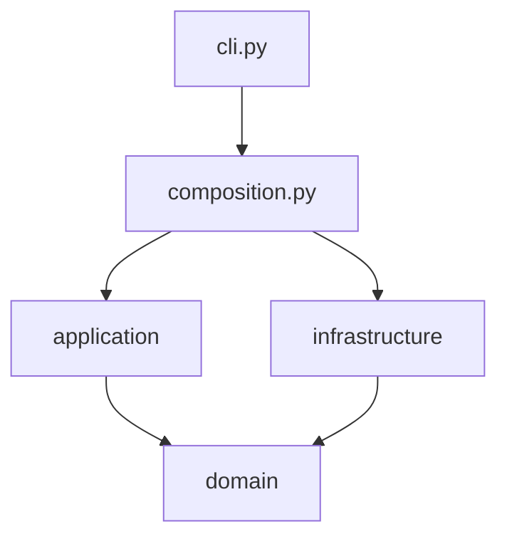
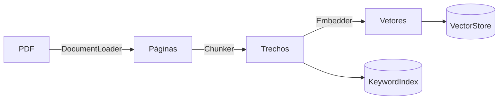
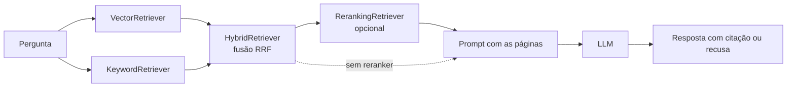

# Arquitetura

O código fica em `src/rag_manual/` e é dividido em camadas. A ideia é simples: as regras do problema não dependem das ferramentas. Dá para trocar o banco vetorial, o modelo de embedding ou o LLM sem mexer na lógica.

## Camadas e regra de dependência

| Camada | Pasta | O que tem | Pode importar |
|---|---|---|---|
| Domínio | `domain/` | Objetos (`Chunk`, `RetrievedChunk`, `Answer`, `GoldenCase`, `RetrievalMetrics`) e as portas (interfaces) | só a biblioteca padrão |
| Aplicação | `application/` | Casos de uso: ingestão, busca, resposta, avaliação | `domain/` |
| Infraestrutura | `infrastructure/` | Adaptadores: pypdf, Chroma, BM25, sentence-transformers, OpenAI/Ollama | `domain/` (e as bibliotecas externas) |
| Composição | `composition.py`, `cli.py` | Monta os objetos a partir das configurações e expõe a linha de comando | todas |

**Regra:** a seta de dependência sempre aponta para o domínio.



- `domain/` não importa nada das outras camadas.
- `application/` só conhece as portas de `domain/ports.py`. Nunca importa uma classe de `infrastructure/`.
- `infrastructure/` implementa as portas.
- `composition.py` é o único lugar que conhece as classes concretas.

Os testes unitários usam fakes em memória das portas (`tests/conftest.py`). Por isso rodam em menos de um segundo, sem baixar modelo.

## Portas

Definidas em `domain/ports.py` com `typing.Protocol`:

| Porta | Método(s) | Adaptador |
|---|---|---|
| `DocumentLoader` | `load(path)` | `PypdfLoader` |
| `Chunker` | `chunk(pages)` | `FixedSizeChunker`, `SectionAwareChunker` |
| `Embedder` | `embed_passages`, `embed_query` | `SentenceTransformerEmbedder` |
| `VectorStore` | `reset`, `add`, `search` | `ChromaVectorStore` |
| `KeywordIndex` | `build`, `search` | `Bm25Index` |
| `Reranker` | `score(query, passages)` | `CrossEncoderReranker` |
| `LLM` | `complete(prompt)` | `OpenAICompatibleLLM` |
| `Retriever` | `search(query, k)` | `VectorRetriever`, `KeywordRetriever`, `HybridRetriever`, `RerankingRetriever` |

Os modelos pesados só são carregados no primeiro uso (carga preguiçosa, dentro dos adaptadores). Não há estado global.

## Ingestão (uma vez)



Caso de uso: `IngestManual` (`application/ingest.py`).

## Consulta (a cada pergunta)



Cada retriever segue a mesma porta (`search(query, k)`). Por isso o `RerankingRetriever` é um decorator: ele recebe qualquer outro retriever e reordena os candidatos.

O prompt fica em um lugar só: `application/answering.py`.

## Configuração

`config.py` define a classe `Settings` (dataclass imutável). Os valores vêm de variáveis de ambiente, com padrão:

| Variável | Padrão | Para que serve |
|---|---|---|
| `RAG_PDF` | `data/manual.pdf` | PDF do manual |
| `RAG_GOLDEN` | `golden.csv` | conjunto de teste |
| `RAG_INDEX_DIR` | `db` | onde ficam o Chroma e o `chunks.json` |
| `RAG_CHUNKER` | veja `config.py` | `fixed` ou `section` |
| `RAG_CHUNK_SIZE`, `RAG_CHUNK_OVERLAP` | 800, 150 | tamanho e sobreposição |
| `RAG_EMBEDDING_MODEL` | veja `config.py` | modelo de embedding |
| `RAG_RERANKER_MODEL` | veja `config.py` | vazio desliga o reranker |
| `RAG_RERANK_CANDIDATES` | 20 | quantos candidatos o reranker reordena |
| `RAG_ANSWER_K` | 5 | trechos enviados ao LLM |
| `LLM_BASE_URL`, `LLM_API_KEY`, `LLM_MODEL` | OpenAI, `gpt-4o-mini` | LLM (Ollama: `http://localhost:11434/v1`) |

As opções da linha de comando (`--chunker`, `--embedding-model`, `--reranker`, `--index-dir`) valem mais que as variáveis.

## Como adicionar uma nova busca

1. Crie uma classe com `search(self, query: str, k: int) -> list[RetrievedChunk]` em `application/retrieval.py` (ou em `infrastructure/`, se depender de uma biblioteca externa).
2. Registre no dicionário de `build_retrievers` em `composition.py` com um nome curto.
3. Pronto: `rag-manual eval` já mede a nova busca junto com as outras.
4. Escreva um teste com os fakes de `tests/conftest.py`.

## Como trocar o LLM

O `OpenAICompatibleLLM` fala com qualquer API compatível com a da OpenAI. Para o Ollama, só mude as variáveis:

```bash
LLM_BASE_URL=http://localhost:11434/v1 LLM_API_KEY=ollama LLM_MODEL=qwen2.5:3b rag-manual ask "sua pergunta"
```

Para outro tipo de API, crie uma classe com `complete(self, prompt: str) -> str` em `infrastructure/llm.py` e escolha-a em `build_answerer`.

## Como trocar o embedding, o chunker ou o reranker

- **Embedding:** passe `--embedding-model` (ou `RAG_EMBEDDING_MODEL`) e rode `ingest` de novo, em outra pasta (`--index-dir`). Modelos com "e5" no nome recebem os prefixos `query: ` e `passage: ` sozinhos.
- **Chunker:** crie uma classe com `chunk(self, pages) -> list[Chunk]` e registre em `CHUNKERS` (`composition.py`).
- **Reranker:** crie uma classe com `score(self, query, passages) -> list[float]`.

## Decisões

Veja `docs/adr/`.
